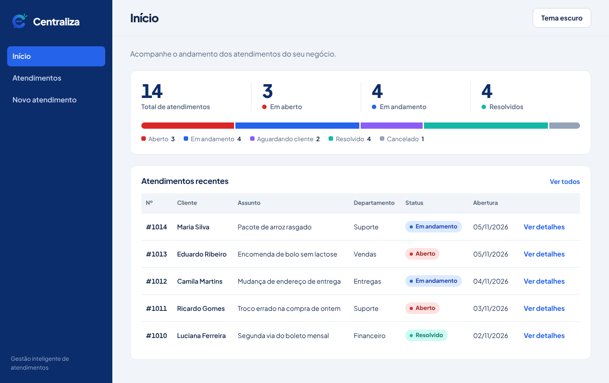
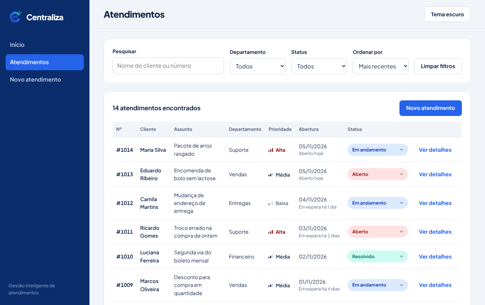
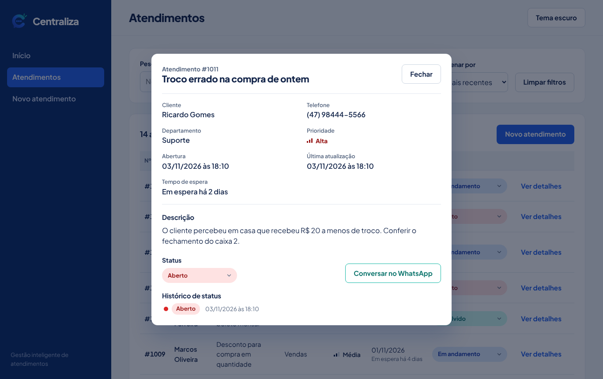
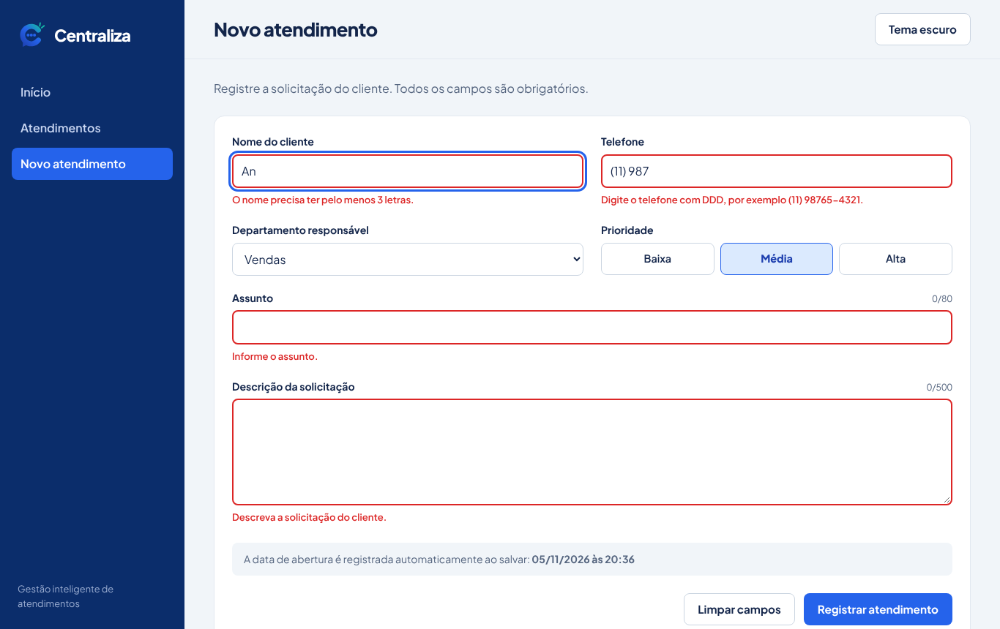
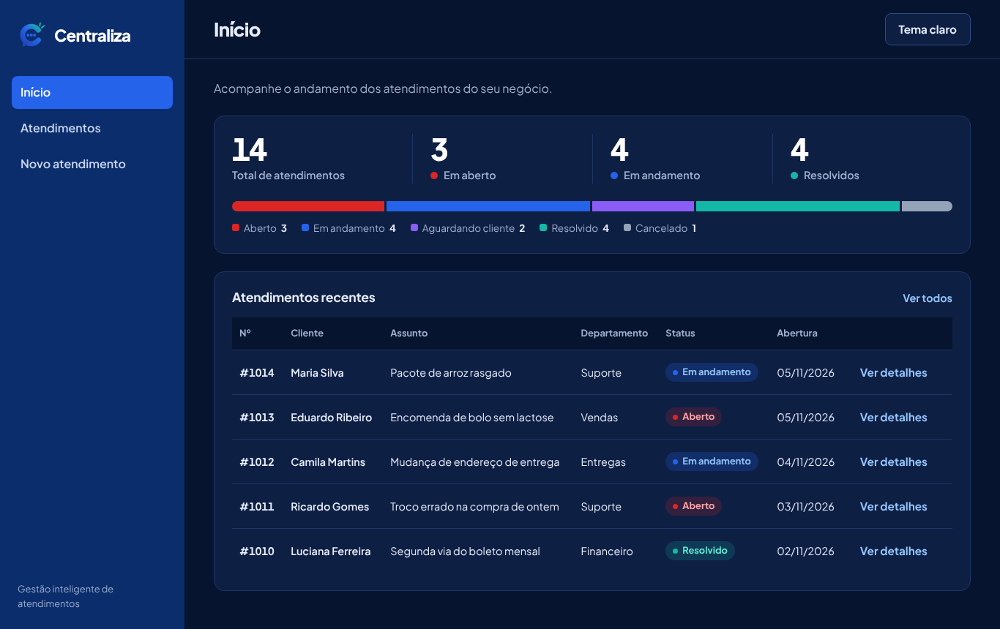
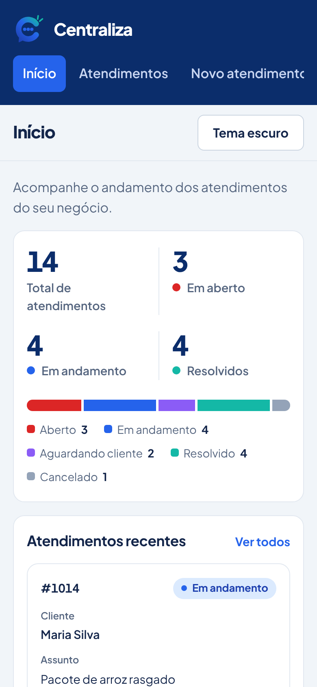
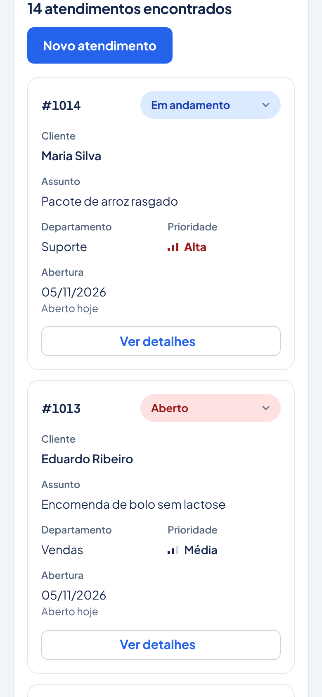
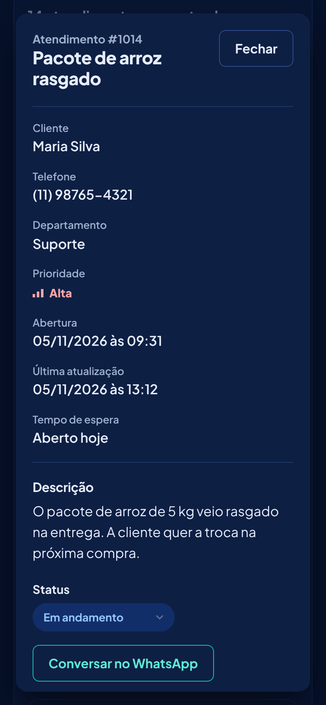

<p align="center">
  
</p>

<h1 align="center">Centraliza</h1>
<p align="center">Gestão inteligente de atendimentos para pequenos comércios.</p>

<p align="center">
  <a href="https://katiadutra.github.io/centraliza/"><strong>Abrir a aplicação</strong></a>
</p>

---

## Sobre o projeto

Pequenos comércios de bairro recebem pedidos e reclamações pelo WhatsApp, pelo telefone e no balcão. Sem um lugar único para registrar tudo, fica difícil saber o que está pendente, quem está esperando resposta e o que é prioridade.

O Centraliza reúne esses atendimentos em um só lugar. A equipe registra cada solicitação, acompanha o status, pesquisa pelo cliente e vê os indicadores gerais na tela inicial. A interface foi pensada para funcionar também no celular, no balcão da loja.

Desenvolvido com HTML, CSS e JavaScript puro, sem frameworks nem bibliotecas.

## Capturas de tela

| Início | Atendimentos |
|---|---|
|  |  |

| Detalhes do atendimento | Cadastro com validação |
|---|---|
|  |  |

| Tema escuro | Celular: início | Celular: lista | Celular: detalhes |
|---|---|---|---|
|  |  |  |  |

## Funcionalidades

**Cadastro**

- Nome do cliente, telefone, departamento, prioridade, assunto e descrição.
- Número sequencial a partir de #1001, que nunca se repete, e data de abertura registrados automaticamente.
- Todo atendimento novo começa com o status "Aberto".
- Validação com a mensagem de erro junto de cada campo e foco no primeiro campo com problema.
- Máscara de telefone durante a digitação e contadores de caracteres.

**Consulta**

- Tela inicial com indicadores (total, em aberto, em andamento e resolvidos), barra de distribuição por status e os cinco atendimentos mais recentes.
- Listagem com número, cliente, assunto, departamento, prioridade, data de abertura e status. No tablet e no celular, cada linha vira um cartão.
- Pesquisa pelo nome do cliente (sem diferenciar acentos e maiúsculas) ou pelo número, com atualização enquanto se digita.
- Filtros por departamento e status, combináveis com a pesquisa, e botão para limpar tudo.
- Ordenação por data, prioridade ou status, e paginação de 10 em 10.

**Acompanhamento**

- Mudança de status direto na lista ou nos detalhes, entre Aberto, Em andamento, Aguardando cliente, Resolvido e Cancelado.
- Confirmação antes de cancelar um atendimento.
- Detalhes em modal, com o histórico de status em linha do tempo.
- Tempo de espera dos atendimentos não encerrados, com destaque a partir de 5 dias.
- Botão para conversar com o cliente no WhatsApp, com mensagem pronta.
- Exclusão de atendimentos registrados por engano, a partir dos detalhes e com confirmação. O número excluído não é reaproveitado.

**Geral**

- Dados salvos no navegador (`localStorage`). Se os dados salvos estiverem corrompidos ou o navegador bloquear o armazenamento, a aplicação avisa e continua funcionando.
- Tema claro e escuro: segue a configuração do sistema e lembra a escolha feita.
- Avisos de sucesso e erro na própria tela, sem `alert()`.

## Tecnologias

- HTML5 semântico
- CSS3 com variáveis, Grid e Flexbox
- JavaScript com ES Modules
- `localStorage` para guardar os dados
- Fonte [Plus Jakarta Sans](https://fonts.google.com/specimen/Plus+Jakarta+Sans)

## Como executar

O projeto usa ES Modules (`import` e `export`), que os navegadores só carregam a partir de um servidor. Abrir o `index.html` com duplo clique não funciona.

**Com o VS Code**

1. Instale a extensão **Live Server**.
2. Abra a pasta do projeto.
3. Clique com o botão direito no `index.html` e escolha **Open with Live Server**.

**Com Python**

```bash
python -m http.server 8000
```

Depois acesse `http://localhost:8000`.

### Dados de exemplo

No primeiro acesso, a aplicação carrega 14 atendimentos de exemplo de um mercadinho de bairro, para a demonstração não começar vazia. Para recomeçar, rode no console do navegador (F12):

```js
localStorage.clear();
location.reload();
```

Os exemplos voltam. Para começar realmente vazio, rode `localStorage.setItem('centraliza:atendimentos', '[]')` antes de recarregar.

## Estrutura de pastas

```
centraliza/
├── index.html            Estrutura das três telas e dos dois modais
├── assets/               Ícone, ícone de aplicativo e favicon em SVG
├── css/
│   ├── base.css          Paleta, tema escuro, reset e acessibilidade
│   ├── layout.css        Menu lateral, topo e responsividade geral
│   └── components.css    Botões, indicadores, tabela, formulário, modais e avisos
├── js/
│   ├── main.js           Estado da aplicação, navegação e eventos
│   ├── atendimentos.js   Regras: validar, criar, excluir, filtrar, ordenar, paginar, mudar status
│   ├── ui.js             Funções que desenham a interface
│   ├── storage.js        Único arquivo que acessa o localStorage
│   ├── config.js         Status, prioridades, departamentos e limites
│   ├── utils.js          Datas, telefone e tratamento de texto
│   └── exemplos.js       Atendimentos de exemplo do primeiro acesso
└── screenshots/
```

### Decisões de organização

- **Regras separadas da tela.** As funções de `atendimentos.js` só recebem e devolvem dados, sem mexer no HTML nem no armazenamento. Por isso podem ser testadas direto no console do navegador.
- **Armazenamento isolado.** Só o `storage.js` acessa o `localStorage`. Para trocar por uma API no futuro, só esse arquivo muda.
- **Uma fonte para as listas fixas.** Status, prioridades e departamentos ficam em `config.js`.
- **Tema escuro com variáveis CSS.** O tema escuro só redefine variáveis de cor. Nenhuma regra de layout é repetida.
- **Segurança.** Todo texto digitado passa por uma função que impede que seja interpretado como HTML. Um nome como `<script>` aparece como texto e não é executado.

## Acessibilidade

- HTML semântico, com rótulo em todos os campos e mensagens de erro ligadas a eles por `aria-describedby`.
- O status nunca é indicado só pela cor: o nome aparece sempre junto.
- Uso completo pelo teclado, com foco visível. Os modais fecham com `Esc` e devolvem o foco ao botão que os abriu.
- Link "Pular para o conteúdo", e anúncio das mudanças de contagem e dos avisos para leitores de tela.
- Respeita a preferência do sistema por menos animação.
- Verificado com [axe](https://github.com/dequelabs/axe-core) nos dois temas, sem problemas encontrados.

## Próximos passos

- Consumir a [BrasilAPI](https://brasilapi.com.br/docs#tag/Feriados-Nacionais) para descontar feriados e calcular o tempo de espera em dias úteis.
- Editar os dados de um atendimento já cadastrado.
- Exportar a lista filtrada em CSV.

## Autora

Desenvolvido por **Katia Dutra**. [GitHub](https://github.com/KatiaDutra)
